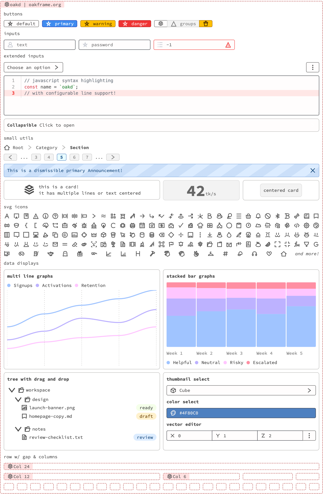

# **oakd React Component Library**

A zero-dependency React component framework for modern TypeScript applications.

`oakd` ships without runtime dependencies beyond React and React DOM as peer
dependencies. That means no styling engine to install, no utility runtime to
carry, and no extra component-layer packages for consumers to manage.

It is designed to give teams a lightweight, framework-style foundation for
layout, typography, inputs, navigation, and composition while keeping install
weight and integration overhead low.

[](https://opensource.org/licenses/MIT)   
[](https://oakd.oakframe.org/)


---

##  **Installation**

To start using `oakd`, install it via npm:

```sh
npm install oakd
```

`react` and `react-dom` should already exist in the consuming application.

Then, **import the styles** in your `App.tsx` (or wherever you use `oakd` components):

```tsx
import "oakd/build/index.css";
```

---

##  **Usage Example**

After installation, use components like:

```tsx
import React from "react";
import "oakd/build/index.css";
import { Title, Paragraph } from "oakd";

const App = () => (
  <div className="app-container">
    <Title>Hello from oakd</Title>
    <Paragraph>Some content</Paragraph>
  </div>
);

export default App;
```

For full-height application workspaces, compose the structural primitives:

```tsx
import {
  AppShell,
  Card,
  Content,
  ContentRail,
  Paragraph,
  ScrollArea,
  Space,
} from "oakd";

const Workspace = () => (
  <AppShell
    header={
      <Content pad>
        <Paragraph>Workspace actions</Paragraph>
      </Content>
    }
    sidebar={
      <Content pad>
        <Paragraph>Navigation</Paragraph>
      </Content>
    }
  >
    <ContentRail size="lg">
      <Card pad>
        <Space direction="vertical" gap wide>
          <Paragraph>Activity</Paragraph>
          <ScrollArea>
            <Paragraph>Activity content</Paragraph>
          </ScrollArea>
        </Space>
      </Card>
    </ContentRail>
  </AppShell>
);
```

---

##  **Icon Pack & Generation**

The oakd icon pack is custom-designed for OakFrame. All SVG icons are stored in the `src/Icon/asset/` folder. Follow these steps to update or add icons:

1. **Add or update SVG files**:  
   Place your SVG files in the `src/Icon/asset/` directory. File names should follow this pattern:

   ```
   oakd_Icon[A-Z][a-z+].svg
   ```

2. **Run the icon generation script**:  
   Use the following command to generate the icon exports:

   ```sh
   npm run icons
   ```

   This script creates a file named `src/Icon/Icons.bin.tsx`, which includes:
   - An `iconMap` object mapping icon names to components (e.g., `{ Angle: IAngle, Trash: ITrash }`).
   - Individual icon components (e.g., `IconTrash`, `IconUser`, etc.).

3. **Icons are automatically included**:  
   Once the script runs, all icons are ready to use with proper paths and inlined assets.

---

##  **Development**

###  **Testing**

Run all tests using Jest:

```sh
npm run test
```

Jest is configured to:

- Use `ts-jest` for TypeScript support.
- Ignore `node_modules/`.
- Output coverage reports in the `coverage/` directory.

###  **Building**

Compile the library for production:

```sh
npm run build
```

**Rollup is configured to:**

- Output both CommonJS (`build/index.js`) and ES modules (`build/index.esm.js`).
- Copy `index.css` to `build/` automatically.
- Support image imports with `@rollup/plugin-image`.

###  **Storybook**

Start a live-reloading Storybook instance:

```sh
npm run storybook
```

Export Storybook as static files:

```sh
npm run storybook:export
```

Serve the generated `storybook-static/` folder.

---

##  **Generating New Components**

Easily scaffold a new component using:

```sh
npm run generate YourComponentName
```

This generates:

```sh
/src/YourComponentName
  ├── YourComponentName.tsx
  ├── YourComponentName.mdx
  ├── YourComponentName.stories.tsx
  ├── YourComponentName.test.tsx
  ├── YourComponentName.types.ts
  ├── YourComponentName.css
```

Modify templates under `util/templates` as needed.  
Don’t forget to export your new component in `index.ts`!

---

##  **Linting & Formatting**

The project uses ESLint with a configuration that:

- Enforces best practices for TypeScript and React.
- Uses Prettier (configured to use tabs).
- Ignores generated or binary files (e.g. `*.bin.tsx`) from coverage.

```sh
npm run lint
```

If you want to run the ESLint with fix:

```sh
npm run lint:fix
```

---

##  **Installing Locally**

To test `oakd` in another project (`test-app`) **without publishing**, run:

```sh
npm i --save ../oakd
```

This adds an entry in `package.json`:

```json
"dependencies": {
  "oakd": "file:../oakd"
}
```

###  **Common Issue: Invalid Hook Call**

If you see:

```sh
Invalid hook call. Hooks can only be called inside the body of a function component.
```

This likely means multiple versions of React are installed.  
Fix it by linking React from the consuming app:

```sh
npm link ../test-app/node_modules/react
```

Alternatively, configure Webpack as suggested [here](https://github.com/facebook/react/issues/13991#issuecomment-435587809).

---

##  **Publishing**

###  **Publishing to NPM**

Ensure you're logged in:

```sh
npm login
```

Update `package.json` with your NPM package name, then publish:

```sh
npm publish
```

The `"prepublishOnly": "npm run build"` script ensures a fresh build before publishing.

###  **Hosting via GitHub**

Alternatively, push the built package to GitHub and install it via:

```sh
npm i --save git+https://github.com/arkamedus/oakd.git#branch-name
```

or

```sh
npm i --save github:arkamedus/oakd#branch-name
```

---

##  **Styling**

OakD retains global system light/dark theming. Its stable customization tokens
use the `--oakd-*` prefix, including `--oakd-background`, `--oakd-font-color`,
`--oakd-font-family`, `--oakd-font-family-display`, `--oakd-leading`,
`--oakd-gap`, `--oakd-radius`, and semantic color/border/text token sets.
Surfaces and controls use `--oakd-radius` directly, without component-specific
multipliers. Pills and circular indicators use `--oakd-radius-round`; joined
edges remain square. Fixed dropdown menus carry scoped OakD tokens into their
body portals. Code displays share `--oakd-font-family-mono`.

Use the original composition model for normal document layout:

- `Page` owns page-level height and fixed behavior.
- `Content`, `Row`, `Col`, and `Space` own flow and grid composition.
- `Card` is a bordered semantic surface.
- `AppShell`, `ScrollArea`, and `Dock` are for explicit application or
  editor-region ownership.

### **Importing Styles**

Include the library’s styles in your project:

```tsx
import "oakd/build/index.css";
```

### **Using CSS Variables**

Use the canonical tokens defined in `src/index.css`. Legacy token names are no
longer supported; see [the migration table](MIGRATION_V4.md#themes).
Component-local variables also use `--oakd-*`, including CodeArea’s
`--oakd-code-padding-x`, `--oakd-code-padding-y`, and `--oakd-code-gutter-width`.
Override these on the CodeArea host through its `style` prop or a CSS selector.

```css
.example-container {
  color: var(--oakd-white);
  background-color: var(--oakd-black);
}
```

More on [CSS Variables](https://developer.mozilla.org/en-US/docs/Web/CSS/Using_CSS_custom_properties).

---

##  **Additional Features**

###  **Dark Mode Support**

Automatically adapts to dark mode using:

```css
@media (prefers-color-scheme: dark) { ... }
```

Customization options are in [`src/index.css`](src/index.css).

###  **CSS Preprocessor Support**

Supports **Sass, Less, Stylus** via:

```sh
yarn add node-sass --dev  # Sass
yarn add stylus --dev      # Stylus
yarn add less --dev        # Less
```

For **CSS Modules**, update `rollup-config.js`:

```js
postcss({
  modules: true,
});
```

###  **Styled Components**

See [this branch](https://github.com/HarveyD/react-component-library/tree/styled-components) for implementation.

###  **Code Splitting**

Load components on demand:

```tsx
import TestComponent from "oakd/build/TestComponent";
```

For setup, refer to [this commit](https://github.com/HarveyD/react-component-library/commit/94631be5a871f3b39dbc3e9bd3e75a8ae5b3b759).

###  **Image Importing**

Image imports **now work automatically** without additional configuration. You can use:

```tsx
import logo from "./logo.png";
export const ImageComponent = () => ;
```

###  **JSON Importing**

Install JSON plugin:

```sh
npm i -D @rollup/plugin-json
```

Add it to `rollup-config.js`:

```js
plugins: [json(), ...]
```

Now you can import JSON files:

```tsx
import data from "./some-data.json";
export const JsonDataComponent = () => <div>{data.description}</div>;
```

---

##  **Resources & Links**

-  [Storybook Docs](https://storybook.js.org/)
-  [Rollup Plugins](https://github.com/rollup/plugins)
-  [CSS Variables](https://developer.mozilla.org/en-US/docs/Web/CSS/Using_CSS_custom_properties)
-  [Styled Components](https://styled-components.com/)

---

##  **Contributing**

We welcome contributions! Open an issue or submit a PR to improve `oakd`.  
For detailed contribution guidelines, refer to our **[Contributing Guide](CONTRIBUTING.md)**.

---

###  **Join the Discussion**

Have questions or ideas? Feel free to reach out on GitHub Discussions or open an issue!
